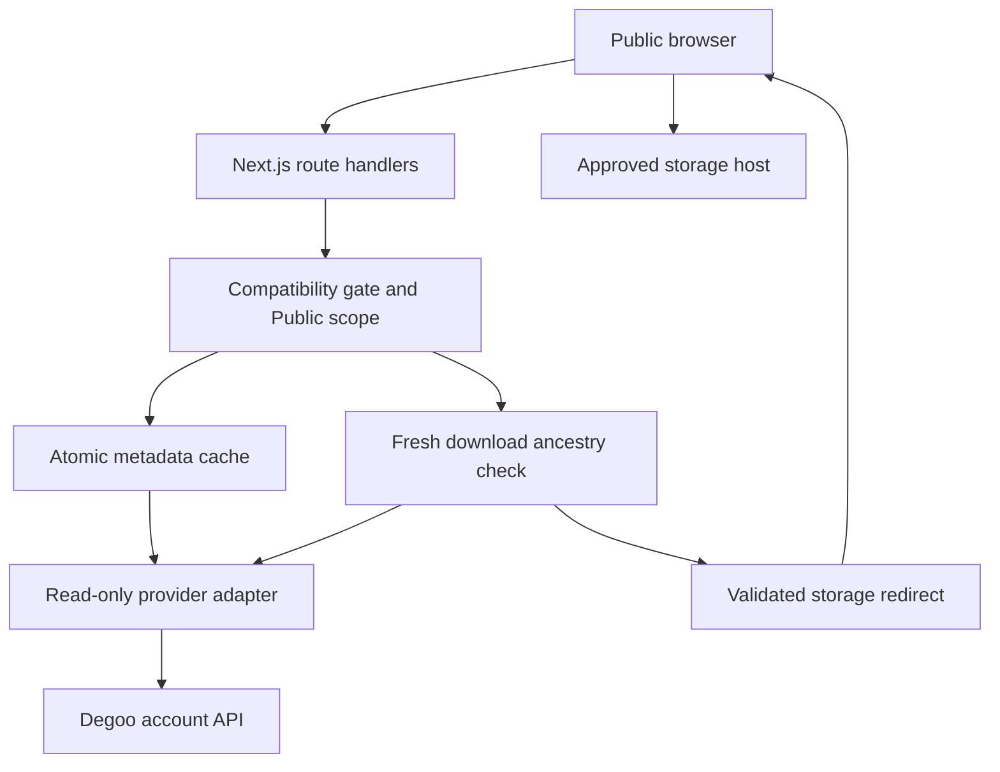

# Architecture and decisions

## Scope

Build a public, read-only folder index for a single Degoo account's explicitly approved folder named `Public`. Stack: Next.js App Router, React, TypeScript, Node runtime, Vercel. Visitors never authenticate to Degoo and cannot enumerate account/device roots. The account login capability exists only inside the server adapter and local verification CLI.

## Why this differs from a Google Drive backend

The reference app supplies a useful browsing/preview/public-sharing model. Its Google Drive auth, shared-file permissions and download assumptions are provider-specific. This project implements a fresh provider boundary; it does not mechanically substitute Degoo URLs into Google Drive code.

The researched Degoo integrations use login/refresh plus GraphQL file children and overlays. Those source contracts are evidence for an experimental adapter, not evidence that a current account can download on Vercel. Live activation therefore requires an exact known-file byte comparison.

## Contracts

`Provider` exposes only `get`, `children`, `download`, and `rootId`. It intentionally has no mutation methods. Demo and Degoo use the same catalog and route service.

`Item` includes ID, direct parent ID, name, kind, byte count, modification time, and recycle-bin state. Parsers fail on missing safety-relevant fields. Numeric IDs are accepted only when safely representable, then normalized to strings. All visible paths are computed from the approved root; upstream full paths and parent metadata above Public are not returned to visitors.

| Route | Purpose | Controls |
| --- | --- | --- |
| `GET /api/list?folder=&q=&page=` | Browse or recursive filename search | Compatibility gate, rooted snapshot membership; 100 entries/page |
| `GET /api/download?id=` | Redirect to fresh file URL | Snapshot membership, live ancestor validation, file-only overlay, HTTPS host allowlist, no-store |
| `GET /api/preview?id=` | Escaped UTF-8 text | Same download checks, format allowlist, bounded read ≤512 KiB |
| `POST /api/bulk` | Recursive stable download manifest | JSON body ≤32 KiB, 1–100 selections, 200-file cap, no arbitrary URLs |
| `GET /api/demo-file?id=` | Local sample bytes/range | Explicit demo mode, fixed asset map; disabled in live mode |

Image/audio/video elements use the scoped download route and then the approved storage redirect. No auth headers or cookies are forwarded to storage. CORS is not assumed for JavaScript reading of redirected file bytes. Text preview uses a small server fetch; bulk exports avoid cross-origin fetch entirely.

HTML, SVG, and documents with active content are never rendered in an iframe or inserted as HTML. React text rendering escapes Markdown/code. Media codecs remain browser-dependent. Unknown types receive a download action.

## Rooted crawl and consistency

The exact configured root must currently be a non-trashed folder named Public. There is no name-based auto-selection of the first matching folder. Starting at that ID, breadth-first traversal verifies direct-parent equality, excludes recycle-bin records, follows pagination to completion and rejects duplicates/cycles. A complete bounded snapshot replaces the previous snapshot atomically. No partial search results are published as a complete index.

Download authorization walks live ancestors of the requested file until it reaches the configured root. It requires each parent relation to match the rooted snapshot and rechecks root identity/name/state. A renamed root, moved ancestor or deleted file denies the download until a new valid snapshot exists.

This is a best-effort snapshot model, not an upstream transaction. Metadata revocation can lag by the configured TTL; a previously issued signed URL remains valid independently. An upstream move after the final ancestry check is a race the adapter cannot lock. For stronger revocation, use a storage system with native scoped tokens or a server-side publish manifest under operator control.

## Cache and serverless economics

One TTL snapshot per worker, with concurrent loads sharing a promise. Expired data is never returned on refresh failure. Raw download URLs are never cached. Tokens remain in process memory with a conservative expiry and single-flight refresh. Secrets are not stored in the cache snapshot, build artifacts or browser bundle.

All public responses use `private, no-store`; HTTP/CDN caching is intentionally separate from the internal metadata cache. A reload does not bypass the internal TTL, preventing arbitrary visitors from forcing upstream crawls. UI reports the cache age and lifetime.

File bytes go from the provider to the visitor, avoiding a large Vercel function response. Vercel documents a 4.5 MB function payload limit, and long archive creation also adds memory/time pressure. Bulk manifests resolve links at download time instead of bundling expired signed URLs or buffering entire archives.

## Compatibility evidence as configuration

The local probe validates the full subtree, resolves a known sample ID, downloads bytes without account credentials at storage, verifies size and SHA-256 against the known original, and observes Range/CORS headers. It emits an operator-controlled report bound to adapter/account/root/key/host scope, valid for seven days. It is not cryptographically attested: operators control environment variables. The purpose is to make verification explicit and avoid enabling an assumed endpoint accidentally.

No public diagnostic route can log in, crawl account roots, modify environment variables or generate a report. No automatic credential retries occur after upstream rejection. Update the adapter and rerun validation when the contract changes.

## Next scale milestone

1. Store immutable scoped snapshots in a durable database/object store. Key by account/root/schema version; never by visitor-supplied ID alone.
2. Move crawling to a controlled background worker with distributed provider throttling, bounded retries for transient errors and cursor checkpoints.
3. Publish a snapshot atomically only after full crawl validation. Track failures and snapshot age explicitly.
4. Use a distributed lock/rate limiter and configure public endpoint abuse controls.
5. If ZIP creation is required, use a dedicated streaming archive service after real provider/CORS tests; do not quietly proxy unlimited file bytes through Vercel.

These are future milestones, not features claimed in this MVP.
